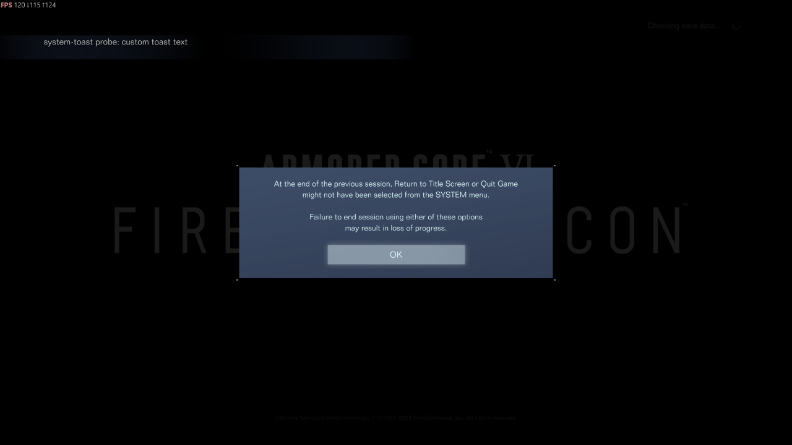

# AC6-Toast-Wrapper (ac6_toast)

One-line notifications ("toasts") for Armored Core VI mods (1.09.1, loaded with [me3](https://github.com/garyttierney/me3)).
They show in the game's own system toast window, top left, with its fade in and out. One DLL owns the toast; any
number of mods call it.



## Using it

1. Build: `cd dll && cargo build --release` → `dll\target\release\ac6_toast.dll`.
2. Add it to your me3 profile:
   ```toml
   [[natives]]
   path = '...\ac6_toast.dll'
   ```
3. In a Rust mod, copy `client\ac6_toast_client.rs` into your crate:
   ```rust
   mod ac6_toast_client;

   ac6_toast_client::show("Saved", 3.0);                       // 3 s on screen
   if let Some(status) = ac6_toast_client::show("Recording", 0.0) { // 0 = until dismissed
       status.update("Recording: 12 found");
       status.dismiss();
   }
   ```
   The client finds the DLL when it's called, so load order doesn't matter. Without the DLL, every call does
   nothing.

Other languages call the exports (UTF-8 text, copied on call; thread-safe; callable before the game is up):

```c
uint32_t ac6_toast_api_version(void);                               // 1
uint64_t ac6_toast_show(const char *text, size_t len, float seconds); // id, 0 = queue full
bool     ac6_toast_update(uint64_t id, const char *text, size_t len); // false = unknown / finished
bool     ac6_toast_dismiss(uint64_t id);
```

`bool` is C's 1-byte `_Bool`; declare it that way in ctypes / C#. `show` also returns 0 if the DLL couldn't hook the
game (wrong game version; the log says why). An export's signature never changes: new features get new exports and
a higher API version, so check `ac6_toast_api_version() >= ` the version you wrote against (the Rust client does).

## Behaviour and limits

- One toast at a time. The rest wait in a queue (64 max) and play in order, each with its own fade.
- `seconds` is time on screen, the fade-out included. Loading screens don't count.
- `update` changes the text in place on screen. `dismiss` fades a toast out, or drops it if it's still queued.
- Keep it to one line, about 85 characters. Longer text wraps to a second line that hangs below the strip.
- Only characters in the game's menu font render (accented Latin works; symbols like ✓ show as a box).
- It sits top left, over the menus' title area (in the garage, under "GARAGE").
- Never load it together with this repo's research probe (`probe-dll\`): both hook the same function.

## Testing

Build `dll\` with `cargo build --release --features debug-hotkey,socket` and `tests\client-test\` with
`cargo build --release`, then `me3 launch -p ac6-toast-test.me3`:
- F7: test toast.
- F8: status toast on and off.
- `python tools\send_toast.py show 5 hello` (also `update <id> <text>`, `dismiss <id>`), through 127.0.0.1:48700.

The profile also loads `tests\client-test` ("client OK" toast after 20 s). Run `cargo test` in `dll\` for the queue
logic. Log: `Game\debug-logs\ac6_toast.log`.

How it works, and the research behind it: `docs\how-it-works.md`, `docs\research-notes.md`.
