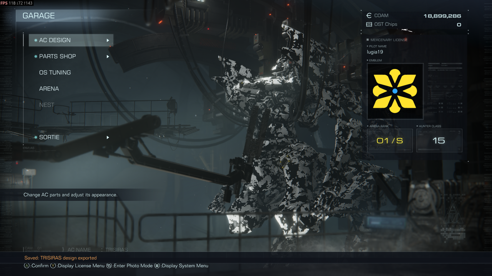
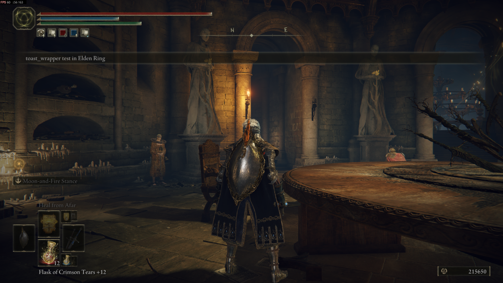

# Toast-Wrapper (toast_wrapper.dll)

One-line notifications for **Armored Core VI** (1.09.1) and **Elden Ring** (1.17.2, Steam build 25827938) mods,
loaded with [me3](https://github.com/garyttierney/me3). They play in the game's own system announce banner, with
its fade in and out. One DLL owns the banner; any number of mods call it. The same DLL works in both games: it
picks the game by its exe.





## Using it

1. Build: `cd dll && cargo build --release` → `dll\target\release\toast_wrapper.dll` (or take it from the releases).
2. Add it to your me3 profile:
   ```toml
   [[natives]]
   path = '...\toast_wrapper.dll'
   ```
3. In a Rust mod, copy `client\toast_wrapper_client.rs` into your crate:
   ```rust
   mod toast_wrapper_client;

   toast_wrapper_client::show("Saved");
   ```
   The client finds the DLL when it's called, so load order doesn't matter. Without the DLL, `show` does nothing and
   returns false.

Other languages call the exports (UTF-8 text, copied on call; thread-safe; callable before the game is up):

```c
uint32_t toast_wrapper_api_version(void);                  // 2
bool     toast_wrapper_show(const char *text, size_t len); // false = not hooked (unsupported game/version) or 64 waiting
```

`bool` is C's 1-byte `_Bool`; declare it that way in ctypes / C#. An export's signature never changes: new features
get new exports and a higher API version, so check `toast_wrapper_api_version() >=` the version you wrote against
(the Rust client does).

## Behaviour and limits

- Texts play one after another, in order. The game decides how long each stays up: about 13 s for a short line in
  AC6, about 15 s in Elden Ring.
- Where it shows: AC6, a strip at the bottom (garage and missions); Elden Ring, a strip near the top, under the
  compass (in game). Not on the title screens: texts sent there wait and play later.
- In AC6 the text gets 18 leading spaces, which line it up with the key guide below it (the banner has no margin of
  its own there). A line wider than the screen scrolls; in AC6 about 150 characters still fit.
- Only characters in the game's menu font render (accented Latin works; symbols like ✓ show as a box).
- No durations, updating or dismissing: the game owns the banner's timing.
- Supported builds only (the log says why it didn't hook otherwise): a game patch needs new addresses in
  `dll\src\game.rs`.

## Testing

Build `dll\` with `cargo build --release --features debug-hotkey,socket` and `tests\client-test\` with
`cargo build --release`, then `me3 launch -p toast-wrapper-test.me3` (AC6) or `toast-wrapper-test-er.me3` (Elden
Ring):
- F7: test text.
- `python tools\send_toast.py hello`, through 127.0.0.1:48700.

The profiles also load `tests\client-test` ("client OK" after 20 s). `cargo test` in `dll\` checks the hand-off to
the game's queue. Log: `Game\debug-logs\toast_wrapper.log` (next to the game's exe).

How it works, and the research behind it: `docs\how-it-works.md`, `docs\research-notes.md`.
